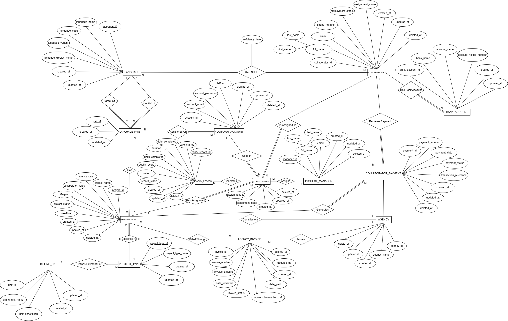
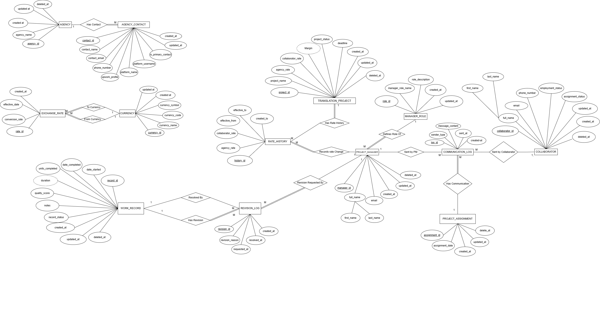
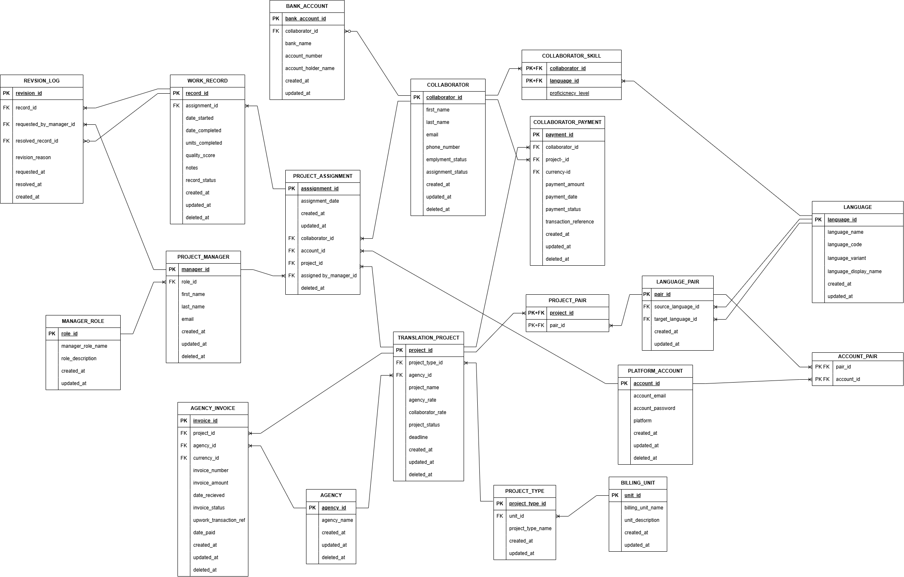
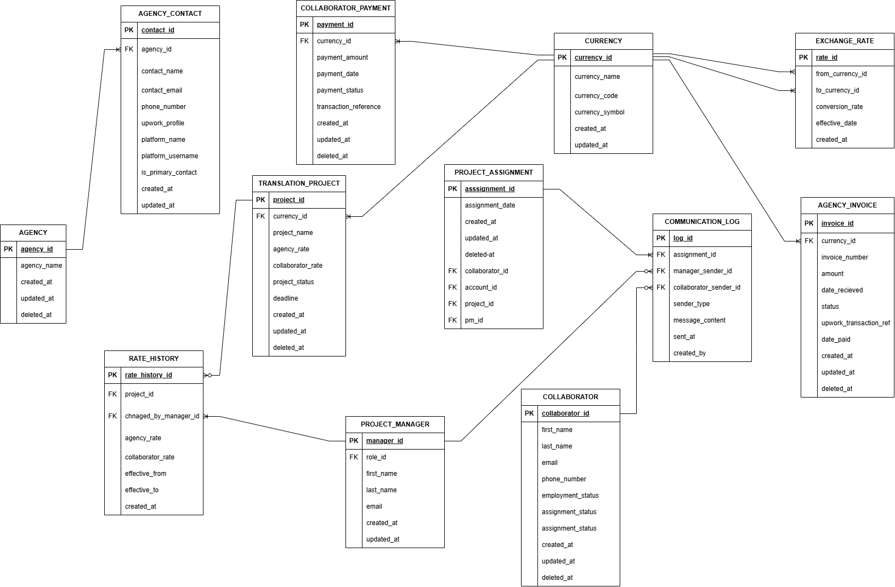

# Diagrams

### All diagrams describe the LinguaSync database (24 tables).

*Main Diagram - conceptual model in Chen notation.*

 
 

*Extended Diagram for chen notation - Tables, keys and relationships in Chen notation.*

 
 

*Main Diagram - : Relationl Diagram with Crow's Foot technique. (close-up of the core tables)*

 
 

*Extended Relational Diagram - : Extension for the close-up of the core tables*

 
 

## Reading Crow's Foot
Cover one table and read the symbol next to the other.
`||` exactly one, `|<` one or many, `O|` zero or one, `O<` zero or many.
A mandatory (NOT NULL) foreign key gives `||` on the parent side.
A nullable one gives `O|`.

For the full explanation, see [Notation Guide](/docs/notation_guide.md).