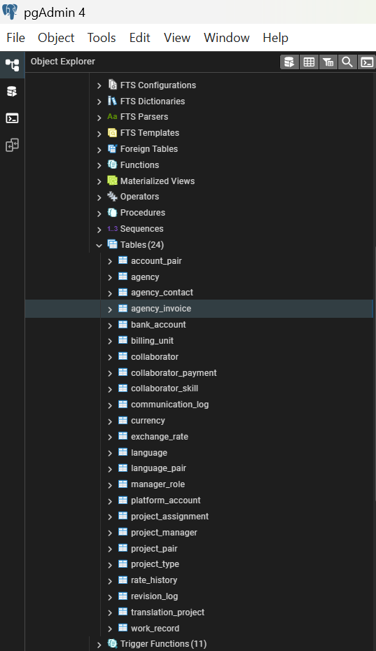
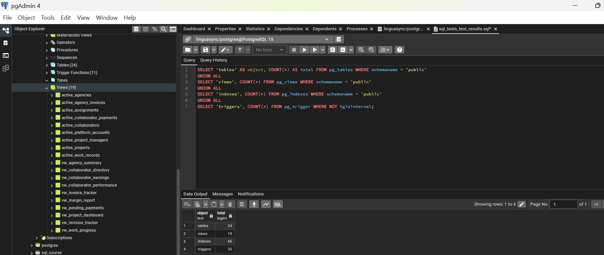
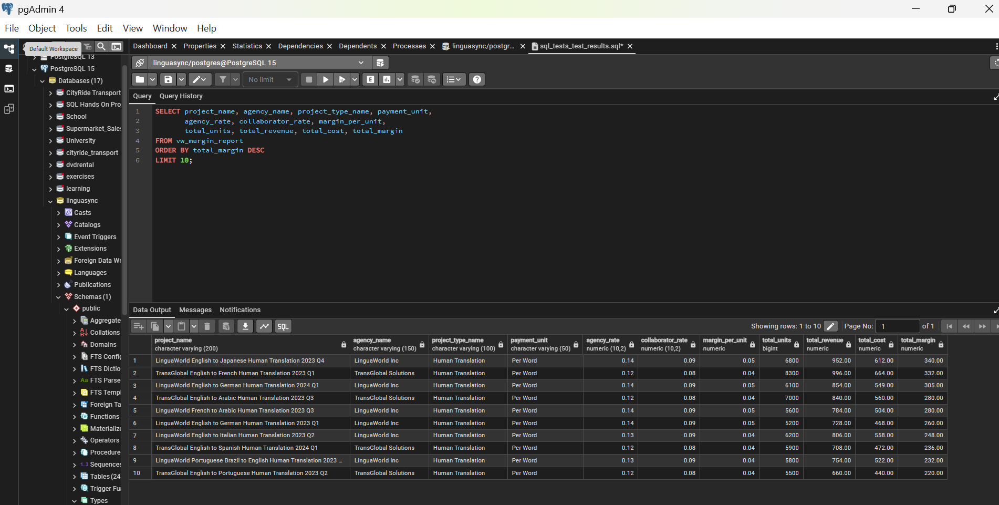
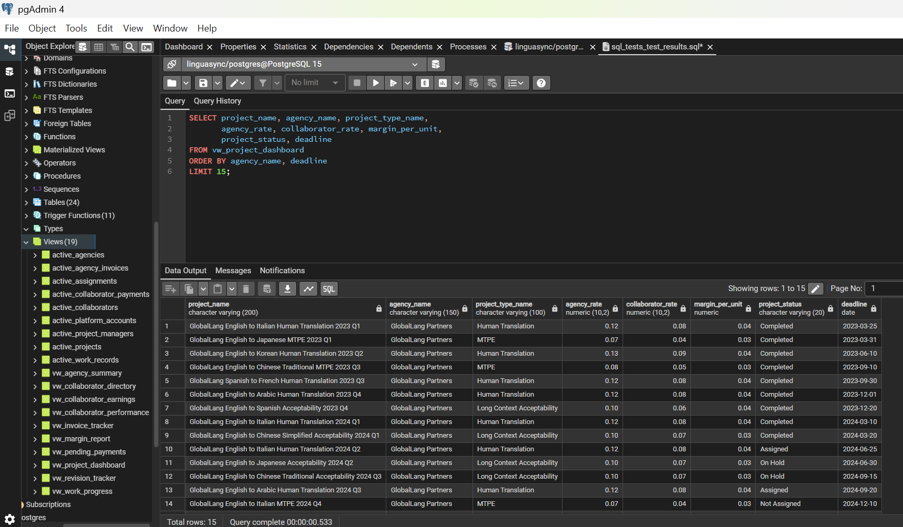
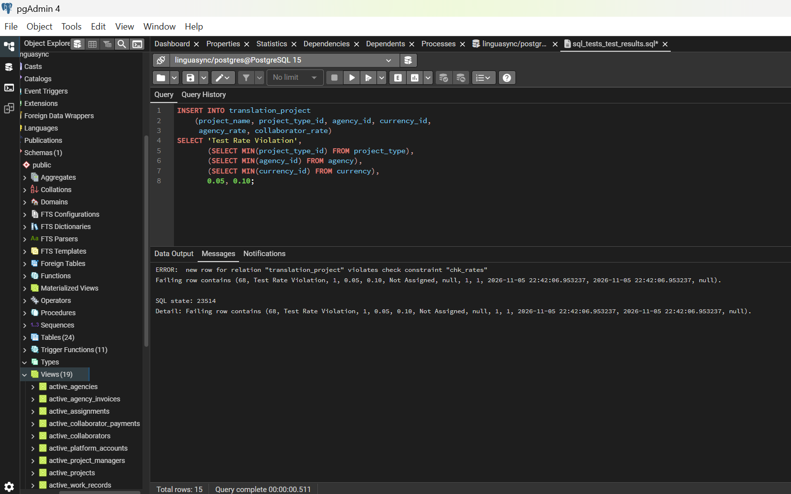
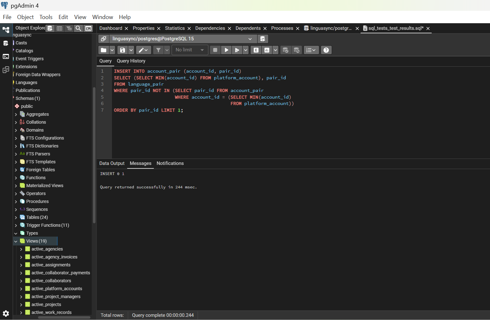
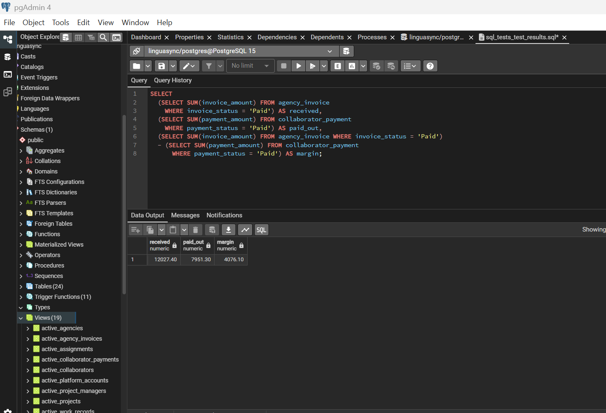

# Screenshots

## Captures of the LinguaSync database running in pgAdmin 4 on PostgreSQL 15. All data shown is fictional demo data.

### Database objects

*LinguaSync Tables - The 24 tables in the public schema*

 
 

 
*LinguaSync Views - The 19 views: 9 active-record views and 10 reporting views*

 
 

#### Reporting views

 
*Project margin report: revenue, cost and margin per project.*

 
 

 
*Project dashboard: agency, type, rates, status and deadline flag*

 
 

#### Tests

 
*A CHECK constraint rejecting invalid data*

 
 

 
*The trigger refusing a sixth language pair on an account*

 
 

 
*Financial reconciliation: 12,027.40 received, 7,951.30 paid out, margin 4,076.10*

 
 

The full test scripts are in `sql/tests/`, with expected and observed
results in `expected_results.md` and `test_results.md`.

For the diagrams, see [Diagrams](/diagram/README.md).